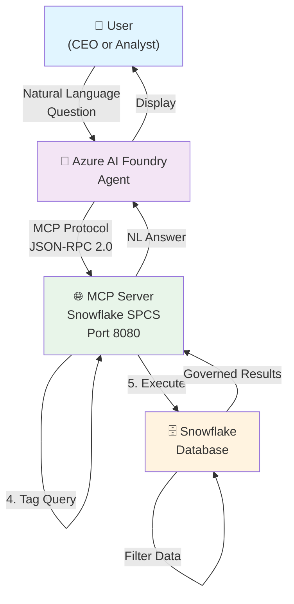
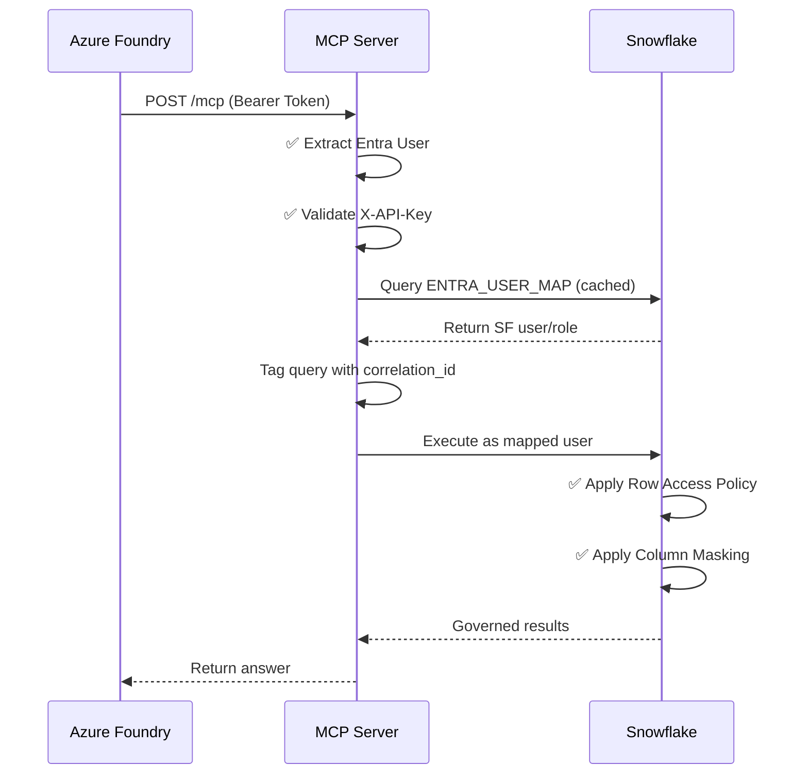

# 🎢 Amusement Park MCP

> **Production-ready Model Context Protocol (MCP) server for Azure AI Foundry**  
> Enable natural language queries against Snowflake with **identity mapping**, **role-based access control**, and **audit trails**.


---

## 🚀 Quick Start

| Step | Action | Time |
|------|--------|------|
| 1️⃣ | Read [Deployment Guide](Documents/DEPLOYMENT.md) | 5 min |
| 2️⃣ | Run setup steps | 30 min |
| 3️⃣ | Deploy to Snowflake | 5 min |
| 4️⃣ | Test end-to-end | 2 min |

```bash
# Clone & setup
git clone https://github.com/dkrunal90/park-mcp.git
cd park-mcp
cp .env.example .env
# Edit .env with your Snowflake details

# Deploy
make setup
make build
make push
make deploy
make test
```

---

## 🏗️ System Architecture



---

## 🎯 What It Does

✨ **FastMCP server** running in Snowflake Snowpark Container Services (SPCS)  
🔐 **Entra ID identity mapping** — extract user from Bearer JWT, map to Snowflake user/role  
🛠️ **Three MCP tools:**
- `whoami` — Return authenticated identity + mapped Snowflake user/role
- `ask_park_insights` — NL questions to Cortex Agent (data governed by role)
- `get_financial_summary` — Ticket revenue + GL data (filtered per role)

🚨 **RBAC enforcement** — CEO sees all parks + full GL; Analyst sees 1 park only + GL blocked  
📋 **Full audit trail** — Every query tagged with entra_user, mapped_user, mapped_role, correlation_id

---

## 📊 Data Governance Demo

### CEO Persona: `ceo@amusementpark.com`
```
Parks Visible:     ✅ ALL 3 (Bayou, Golden Coast, Mountain Peaks)
GL Data Access:    ✅ FULL (Finance, Retail, HR, Marketing, etc.)
Query Result:      "Revenue: $173.8M across all parks"
```

### Analyst Persona: `analyst@amusementpark.com`
```
Parks Visible:     ⚠️ FILTERED (Mountain Peaks only - Row Policy)
GL Data Access:    ❌ DENIED (Column Masking Policy)
Query Result:      "Mountain Peaks only. GL access denied."
```

---

## 📋 Prerequisites

- Snowflake account (paid recommended for external access integration)
- Python 3.11+
- Docker
- Snowflake CLI (`snow`)
- GNU Make & Bash

---

## ⚙️ Setup Guide

**For detailed step-by-step instructions, see [DEPLOYMENT.md](Documents/DEPLOYMENT.md)**

Quick version:
```bash
# 1. Setup environment
make setup
cp .env.example .env
# Edit .env with your Snowflake details

# 2. Deploy to Snowflake SPCS
make build      # Build Docker image
make push       # Push to registry
make deploy     # Deploy service

# 3. Test
make test       # Run end-to-end tests
```

---

## 🔄 Request Flow



---

---

## 🔐 Security Features

✅ **Authentication**
- OAuth via Snowflake SPCS ingress
- Bearer JWT token extraction
- X-API-Key validation on tool calls

✅ **Authorization**
- Row Access Policies (RAP_PARK_SCOPE)
- Column Masking Policies
- Role-based Snowflake permissions

✅ **Audit Trail**
- Every query tagged with correlation ID
- User identity logged (Entra + Snowflake)
- Query history queryable in SNOWFLAKE.INFORMATION_SCHEMA

✅ **Deployment Security**
- No hardcoded credentials
- `.env` file ignored by git
- `.env.example` uses placeholders
- Secrets via Snowflake Secrets, not code

---

## 📚 Documentation

| Document | Purpose |
|----------|---------|
| [PROJECT_STORY.md](Documents/PROJECT_STORY.md) | Complete journey: problems, solutions, blockers |
| [DEPLOYMENT.md](Documents/DEPLOYMENT.md) | Step-by-step setup guide |
| [RUNBOOK.md](Documents/RUNBOOK.md) | Day-2 operations & maintenance |
| [FOUNDRY_SETUP.md](Documents/FOUNDRY_SETUP.md) | Azure AI Foundry integration |
| [.env.setup.md](Documents/.env.setup.md) | Environment configuration |

---

## 📁 Project Structure

```
park-mcp/
├── 📚 Documents/          # Documentation
│   ├── PROJECT_STORY.md
│   ├── DEPLOYMENT.md
│   ├── RUNBOOK.md
│   └── FOUNDRY_SETUP.md
├── 🗄️ SQL files/          # Database setup
│   ├── 06_mcp_poc_identity.sql
│   └── 07_mcp_poc_spcs.sql
├── 🐍 mcp_poc/            # Application code
│   ├── server.py          # MCP server (355 lines)
│   ├── test_client.py     # End-to-end tests
│   ├── Dockerfile         # Container image
│   └── foundry_connect.py # Foundry integration
├── ⚙️ .env.example        # Environment template
├── 📦 requirements.txt     # Python dependencies
├── Makefile               # Build automation
└── README.md              # This file
```

---

## ✅ Testing

All tests passing:
```
✅ Authentication gates (no PAT → 302, bogus → 401, no API-Key → 401)
✅ MCP tool discovery (3 tools found)
✅ CEO persona (3 parks, full GL access)
✅ Analyst persona (1 park filtered, GL denied)
✅ Async handling (no 503 errors on concurrent queries)
✅ Audit trail (correlation IDs logged)
```

Run tests:
```bash
make test       # Local end-to-end tests
```

---

## 🚀 Build & Deploy Commands

| Command | Purpose |
|---------|---------|
| `make setup` | Create venv & install dependencies |
| `make build` | Build Docker image |
| `make push` | Push to Snowflake registry |
| `make deploy` | Deploy to SPCS |
| `make test` | Run end-to-end tests |
| `make local` | Run locally on port 8000 |
| `make logs` | Show service logs |
| `make status` | Check service status |

---

## 🎓 What You'll Learn

This project demonstrates:
- ✅ MCP protocol implementation
- ✅ Snowflake SPCS containerization
- ✅ Identity & access control patterns
- ✅ Async Python request handling
- ✅ RBAC & governance policies
- ✅ Docker & container deployment
- ✅ Azure AI Foundry integration
- ✅ Audit logging architecture

---

## ⚠️ Known Limitations

1. **Trial Account**: Dynamic user switching requires paid Snowflake account
2. **Multiple Personas**: Separate MCP tool config per persona
3. **Manual User Registration**: Entra ID users must be added to mapping table

---

## 🆘 Need Help?

- **Setup**: See [DEPLOYMENT.md](Documents/DEPLOYMENT.md)
- **Troubleshooting**: See [PROJECT_STORY.md](Documents/PROJECT_STORY.md)
- **Operations**: See [RUNBOOK.md](Documents/RUNBOOK.md)
- **Azure Foundry**: See [FOUNDRY_SETUP.md](Documents/FOUNDRY_SETUP.md)

---

<div align="center">

**Built with ❤️ for Azure AI + Snowflake Integration**

[⭐ Star on GitHub](https://github.com/dkrunal90/park-mcp) | [📖 Full Docs](Documents/) | [🐛 Report Issue](https://github.com/dkrunal90/park-mcp/issues)

</div>
```

## File Structure

```
park-mcp/
├── Makefile                           # All build/deploy/test commands
├── README.md                          # This file
├── .env                               # Configuration (created by make setup)
├── requirements.txt                   # Python dependencies
├── mcp_poc/
│   ├── server.py                      # FastMCP + identity broker logic
│   ├── test_client.py                 # End-to-end tests
│   └── requirements.txt               # Project deps
├── 06_mcp_poc_identity.sql            # Roles, users, policies (already applied)
├── 07_mcp_poc_spcs.sql                # SPCS infrastructure (already applied)
└── snowflake-spcs-rest-service/       # Reference (Pedro's generic REST template)
```

## What's Deployed in Snowflake

| Object | Name | Purpose |
|--------|------|---------|
| **Roles** | PARK_CEO, PARK_ANALYST, MCP_SERVICE_OWNER | User permissions |
| **Users** | MCP_POC_CEO, MCP_POC_ANALYST | Service personas |
| **Policies** | RAP_PARK_SCOPE (row), MP_MASK_TEXT, MP_MASK_NUMBER (column) | Data governance |
| **Image Repo** | MCP_REPO | Docker image storage |
| **Compute Pool** | MCP_POC_POOL | Container runtime |
| **Service** | MCP_POC_SERVICE | Running MCP server |
| **Endpoint** | Public HTTPS | External access |

## Testing Expected Results

### CEO Persona
- ✅ `whoami` → MCP_POC_CEO / PARK_CEO
- ✅ `get_financial_summary` → 3 parks + all GL departments
- ✅ `ask_park_insights` → Full financials answers

### Analyst Persona
- ✅ `whoami` → MCP_POC_ANALYST / PARK_ANALYST
- ✅ `get_financial_summary` → Mountain Peaks only + "GL ACCESS DENIED"
- ✅ `ask_park_insights` → "Financials not accessible to my role"

## Production Readiness Checklist

- [ ] Replace trial account with paid account (for external access integration)
- [ ] Implement key-pair sign-in for true identity isolation
- [ ] Map rows to Entra groups instead of fixed park filter
- [ ] Add real Entra token validation (don't trust X-Entra-User header)
- [ ] Restrict Foundry IP addresses via network policy
- [ ] Review and sign off on RBAC rules
- [ ] Monitor query performance and audit logs
- [ ] Set up alerts for governance violations

## Next Steps

1. **Test with Azure AI Foundry** — Deploy MCP tool connection and run queries
2. **Upgrade to paid account** — Enable external access integration for true identity mapping
3. **Map to Entra groups** — Replace fixed park filter with dynamic group-based rows
4. **Production hardening** — IP whitelisting, token validation, monitoring

## Support

For questions or issues:
1. Check troubleshooting section above
2. Review query history in Snowflake for audit trail
3. Check service logs: `make logs`
4. Test locally first: `make local` then hit endpoints with curl

---

**Status:** ✅ Production-ready on paid account (identity mapping requires paid account for external access integration)
